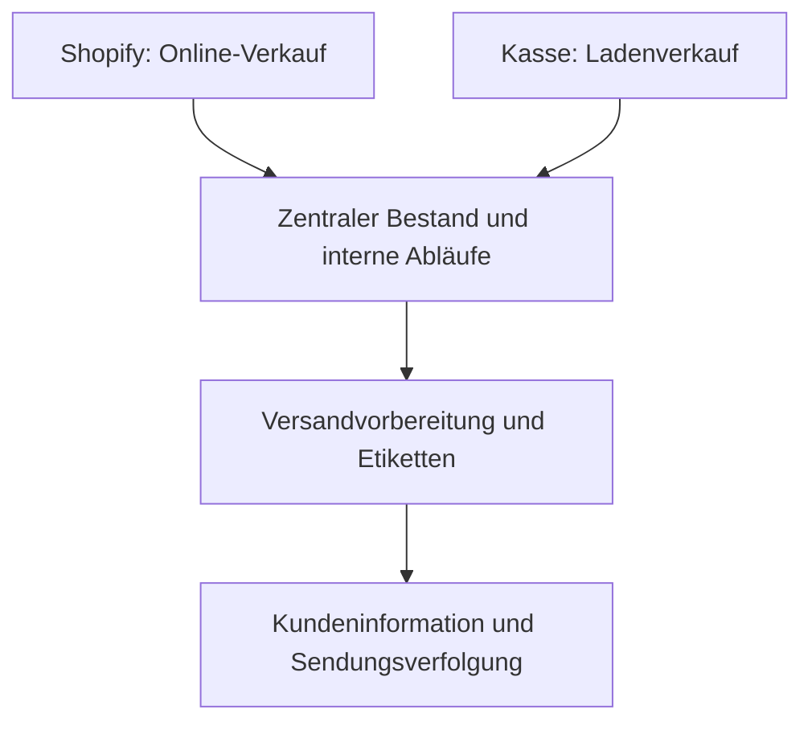

# Doctor K – E-Commerce und Prozessautomatisierung
**Praxisprojekt von Hassieb Kalla · Shopify, n8n und betriebliche Integrationen**

Für den familiennahen Handelsbetrieb hinter Doctor K habe ich Shopify, Kasse, Lager und wiederkehrende Kundenkommunikation miteinander verbunden. Ziel war, manuelle Arbeit zu reduzieren und Online- und Ladenverkäufe in zusammenhängenden Abläufen zu bearbeiten.

**Projektkontext:** Doctor K ist ein Handels- und E-Commerce-Projekt im familiären Umfeld.

## Mein Beitrag
Mein Beitrag umfasst den Aufbau des Shopify-Shops, die Verbindung von Kasse und Bestand sowie interne Anwendungen und Automatisierungen. Bei der Entwicklung nutze ich KI-Unterstützung, unter anderem Claude Code. Ein Schwerpunkt war die Übertragung bestehender Klaviyo-Flows auf selbst gehostetes n8n.

## Umsetzung
| Bereich | Projektbeitrag |
| --- | --- |
| E-Commerce | Shopify-Shop aufgebaut |
| Kasse und Lager | Kassensystem und zentralen Bestand für Online- und Ladenverkäufe verbunden |
| Interne Abläufe | Dashboard und interne Anwendung aufgebaut |
| Versand | Versandvorbereitung, Etiketten, Bestandsabbuchungen und E-Mails mit Sendungsverfolgung automatisiert |
| E-Mail-Workflows | Bestehende Klaviyo-Flows auf selbst gehostetes n8n übertragen, um laufende Plattformkosten zu reduzieren |
| Telefon | KI-Telefonassistent für Beratungsanfragen umgesetzt |

## Fachlicher Ablauf
Vereinfachte Übersicht, kein technisches Deployment-Schema:

Die Automatisierung verbindet einzelne Arbeitsschritte: Bestellungen, Bestandsveränderungen, Versand und Kundeninformation werden gemeinsam betrachtet. n8n übernimmt wiederkehrende E-Mail-Abläufe; der Telefonassistent ergänzt die Kundenkommunikation.

## Ergebnis

Online- und Ladenverkäufe sind über den zentralen Bestand verbunden. Versandvorbereitung, Etiketten und Kundeninformationen wurden in zusammenhängende Abläufe übertragen. Wiederkehrende E-Mail-Flows laufen über selbst gehostetes n8n.

**Interne Schätzungen:** etwa drei Stunden tägliche Entlastung der Geschäftsführung und mindestens eine Stunde weniger Telefonaufwand. Die Zeitangaben können sich überschneiden und werden nicht addiert. Umsatzangaben werden erst ergänzt, wenn Kennzahl und Vergleichszeitraum eindeutig dokumentiert sind.

## Was ich im Gespräch zeigen kann
Ich erläutere gern den Bestellablauf, die Migration von Klaviyo zu n8n und meinen konkreten Anteil an den Integrationen. Geeignete Einblicke in interne Anwendungen können nach Abstimmung gezeigt werden.

**Veröffentlichungsumfang:** Projektbeschreibung aus eigener Arbeit; interner Quellcode und Kundendaten bleiben privat.

[LinkedIn](https://www.linkedin.com/in/hassieb-kalla-mindrails/) · [Weitere öffentliche Projekte](PORTFOLIO.md)
