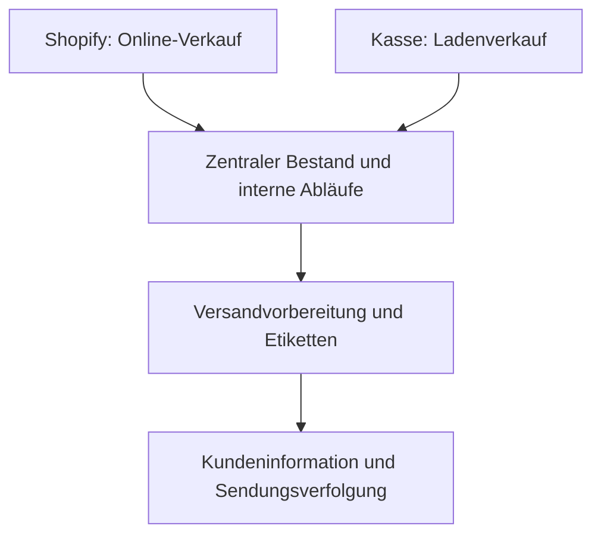

# Doctor K – E-Commerce und Prozessautomatisierung
**Praxisprojekt von Hassieb Kalla · Stand: 22. Oktober 2026**

Für den familiennahen Handelsbetrieb hinter Doctor K habe ich Shopify, Kasse, Lager und wiederkehrende Kundenkommunikation miteinander verbunden. Ziel war, manuelle Arbeit zu reduzieren und Online- und Ladenverkäufe in zusammenhängenden Abläufen zu bearbeiten.

> Doctor K bezeichnet hier das Handelsprojekt, keine Arztpraxis. Diese Fallstudie dokumentiert meine Projektarbeit; der interne Quellcode ist nicht veröffentlicht. Phonbot ist ein separates Voice-Agent-Projekt und kein Quellcode-Nachweis für sämtliche hier beschriebenen Funktionen.

## Mein Beitrag
Ich habe den Shopify-Shop aufgebaut und interne Anwendungen und Automatisierungen umgesetzt. Meine Kenntnisse habe ich mir praktisch erarbeitet. Bei der Softwareentwicklung nutze ich KI-Unterstützung, unter anderem Claude Code. Meine Arbeit verbindet Prozessverständnis, Anforderungsaufnahme und praktische Umsetzung.

## Umsetzung
| Bereich | Projektbeitrag |
| --- | --- |
| E-Commerce | Shopify-Shop aufgebaut |
| Kasse und Lager | Kassensystem und zentralen Bestand für Online- und Ladenverkäufe verbunden |
| Interne Abläufe | Dashboard und interne Anwendung aufgebaut |
| Versand | Versandvorbereitung, Etiketten, Bestandsabbuchungen und E-Mails mit Sendungsverfolgung automatisiert |
| E-Mail-Workflows | Bestehende Klaviyo-Flows auf selbst gehostetes n8n übertragen, um laufende Plattformkosten zu reduzieren |
| Telefon | KI-Telefonassistent für Beratungsanfragen umgesetzt |

## Fachlicher Ablauf
Vereinfachte Übersicht, kein technisches Deployment-Schema:

Die Automatisierung verbindet einzelne Arbeitsschritte: Bestellungen, Bestandsveränderungen, Versand und Kundeninformation werden gemeinsam betrachtet. n8n übernimmt wiederkehrende E-Mail-Abläufe; der Telefonassistent ergänzt die Kundenkommunikation.

## Beobachtete Wirkung
**Interne Einschätzungen des Projektverantwortlichen, keine unabhängig validierten Messwerte.** Ein genauer Vergleichszeitraum und eine kontrollierte Abgrenzung anderer Einflussfaktoren liegen für diese Veröffentlichung nicht vor.

| Beobachtung | Interne Einschätzung |
| --- | --- |
| Online-Verkäufe | Etwa +300 % |
| Monatlicher Gesamtumsatz | Etwa das 1,5-Fache |
| Entlastung der Geschäftsführung | Etwa drei Stunden täglich |
| Reduzierter Telefonaufwand | Mindestens eine Stunde täglich |

Die Umsatzentwicklung wird nicht ausschließlich der Automatisierung zugerechnet. Die Zeitangaben können sich überschneiden und werden nicht addiert.

## Was ich im Gespräch zeigen kann
Ich erläutere gern den Bestellablauf, die Migration von Klaviyo zu n8n und meinen konkreten Anteil an den Integrationen. Geeignete Einblicke in interne Anwendungen können nach Abstimmung gezeigt werden.

Diese Fallstudie basiert auf meiner Projektbeschreibung. Sie enthält keine Kundendaten, Zugangsdaten, Anrufmitschnitte oder internen Systemadressen. Eine unabhängige Funktionsprüfung des Systems ist damit nicht verbunden.

[LinkedIn](https://www.linkedin.com/in/hassieb-kalla-mindrails/) · [Weitere öffentliche Projekte](PORTFOLIO.md)
