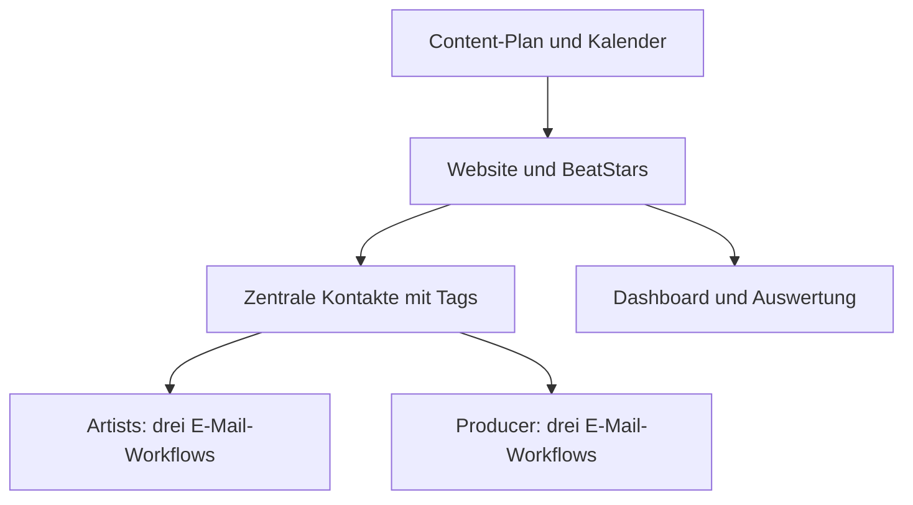

# E-Mail-Automatisierung für einen Musikproduzenten

**Praxisprojekt von Hassieb Kalla · n8n, Kontaktsegmentierung und Content-Abläufe**

Für einen Musikproduzenten habe ich wiederkehrende Kommunikations- und Planungsaufgaben in zusammenhängende Abläufe übertragen. Zwei Zielgruppen standen im Mittelpunkt: Artists und andere Producer.

## Mein Beitrag

| Aufgabe | Umsetzung |
| --- | --- |
| Zielgruppenspezifische Kommunikation | Sechs E-Mail-Workflows: jeweils drei für Artists und Producer |
| Kontakte organisieren | Zentrale Kontaktdatenbank mit Tags zur Segmentierung |
| Kontaktgewinnung verbinden | Abläufe rund um Website, BeatStars und kostenlose Beats |
| Wiederkehrende Kommunikation | DM-Automatisierung |
| Content organisieren | Content-Plantabelle, Kalender und automatisches Posten |
| Überblick schaffen | Internes Dashboard mit Datenbank und Reel-Analytics |
| Marketing unterstützen | Unterstützung bei Content-Erstellung sowie Social- und Meta-Ads-Planung |

Ich habe die technischen Abläufe mit KI-Unterstützung umgesetzt. Der Schwerpunkt lag darauf, Kontaktgewinnung, Zielgruppenzuordnung und wiederkehrende Kommunikation zusammenzuführen.

## Fachliches Ablaufmodell

Vereinfachtes fachliches Modell; keine technische Darstellung sämtlicher Integrationen.

## Ergebnis und Nachweisumfang

Entstanden sind sechs zielgruppenspezifische E-Mail-Workflows, eine strukturierte Kontaktbasis sowie Werkzeuge für Content-Planung und Auswertung. Für dieses Projekt veröffentliche ich keine Umsatz-, Conversion- oder Zeitersparniswerte, da dazu keine belegten Zahlen vorliegen.

Die Beschreibung beruht auf meiner Projektarbeit. Kundennamen, Kontaktdaten und interne Workflow-Exporte bleiben vertraulich. Im Gespräch erläutere ich gern die Segmentierung, die einzelnen Prozessschritte und meinen Beitrag.

[Zur Projektübersicht](PORTFOLIO.md) · [LinkedIn](https://www.linkedin.com/in/hassieb-kalla-mindrails/)
